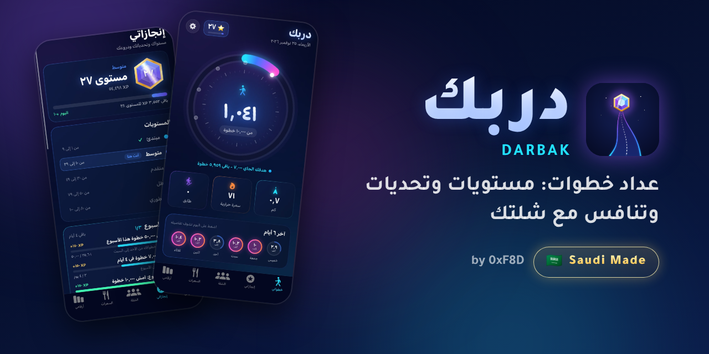
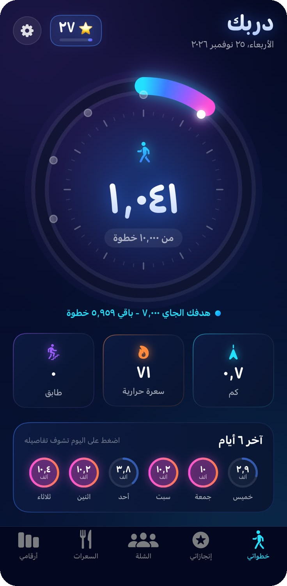
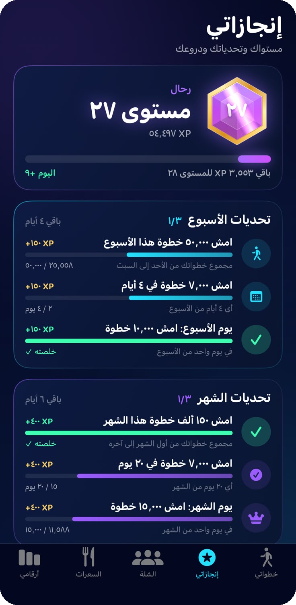
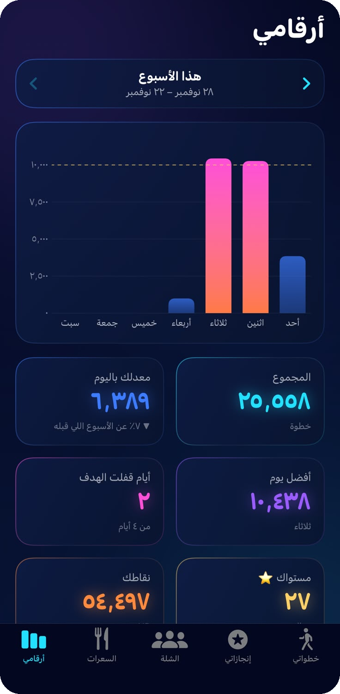

<div align="center">



# دربك · Darbak

عداد خطوات: مستويات وتحديات وتنافس مع شلتك

[](https://github.com/0xF8D/Darbak/releases/download/latest/Darbak.ipa)

iOS 16.2+ · iPhone & iPad · by **0xF8D** · Saudi Made

</div>

<p align="center">
  
  
  
  
  
</p>

## المميزات

- **خطوات مباشرة** من «صحتي» (الجوال والساعة)
- **مستويات** من مبتدئ إلى أسطوري
- **تحديات** أسبوعية وشهرية
- **الشلة**: مجموعات بكود، وتشوف خطوات أصحابك تتحدث كل دقيقة
- **دروع** لكل يوم توصل فيه هدفك
- **ويدجت** وشاشة القفل
- **السعرات**: حاسبة وسجل يومي

## التثبيت

1. حمّل [Darbak.ipa](https://github.com/0xF8D/Darbak/releases/download/latest/Darbak.ipa)
2. ثبته بأي برنامج تثبيت (AltStore أو Sideloadly)
3. اسمح للتطبيق يقرأ من «صحتي»

مصدر AltStore:

```
https://raw.githubusercontent.com/0xF8D/Darbak/main/apps.json
```

## الخصوصية

بياناتك تبقى في جوالك. لو دخلت مجموعة، ينحفظ اسمك ورمزك ومستواك وخطوات أسبوعك بس، وما يشوفها إلا أعضاء مجموعتك. ما فيه حسابات ولا إيميل.

## البناء

SwiftUI + XcodeGen، ويتبنى تلقائي على GitHub Actions مع كل تحديث على `main`. المجموعات تشتغل على Supabase (`supabase/schema.sql`).

---

## English

**Darbak** is a step counter for iPhone & iPad with levels, weekly and monthly challenges, and friend groups (join with an 8-character code, live leaderboard). Steps come from Apple Health (iPhone + Apple Watch). Only your name, emoji, level and weekly steps are shared, and only with your group.

[Download the latest IPA](https://github.com/0xF8D/Darbak/releases/download/latest/Darbak.ipa) and sideload it with AltStore or Sideloadly.

---

<p align="center">© 2026 0xF8D · Saudi Made</p>
