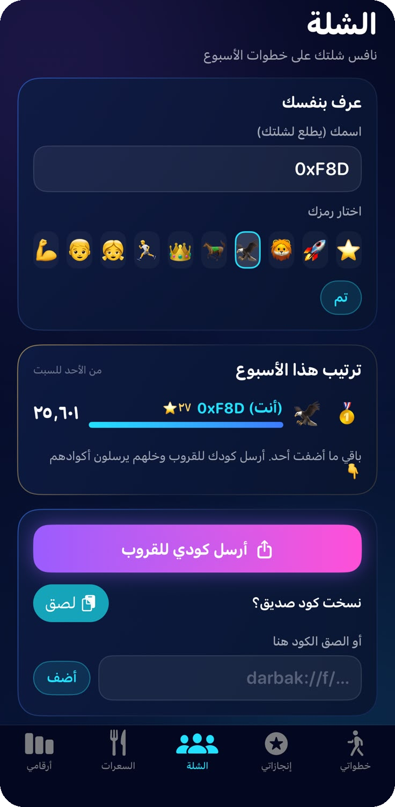
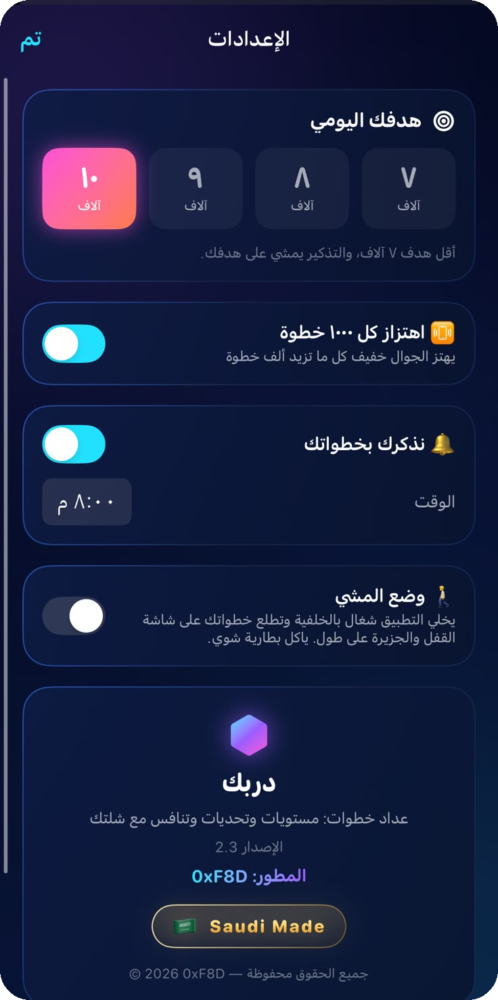

<div align="center">


# دربك · Darbak

عداد خطوات: مستويات وتحديات وتنافس مع شلتك

[](https://github.com/0xF8D/steps/releases/download/latest/Darbak.ipa)

iOS 16.2+ · iPhone & iPad · by **0xF8D** · Saudi Made

</div>

<p align="center">
  
  
  
  
  
</p>

## المميزات

- **خطوات مباشرة** من «صحتي» (الجوال والساعة)
- **مستويات** من مبتدئ إلى أسطوري
- **تحديات** أسبوعية وشهرية
- **الشلة**: نافس أصحابك على خطوات الأسبوع
- **دروع** لكل يوم توصل فيه هدفك
- **ويدجت** وشاشة القفل
- **السعرات**: حاسبة وسجل يومي

## التثبيت

1. حمّل [Darbak.ipa](https://github.com/0xF8D/steps/releases/download/latest/Darbak.ipa)
2. ثبته بأي برنامج تثبيت (AltStore أو Sideloadly)
3. اسمح للتطبيق يقرأ من «صحتي»

مصدر AltStore:

```
https://raw.githubusercontent.com/0xF8D/steps/main/apps.json
```

## الخصوصية

كل بياناتك تبقى في جوالك. ما فيه سيرفر ولا حسابات.

## البناء

SwiftUI + XcodeGen، ويتبنى تلقائي على GitHub Actions مع كل تحديث على `main`.

---

## English

**Darbak** is a step counter for iPhone & iPad with levels, weekly and monthly challenges, and a friends leaderboard. Steps come from Apple Health (iPhone + Apple Watch). All data stays on your device.

[Download the latest IPA](https://github.com/0xF8D/steps/releases/download/latest/Darbak.ipa) and sideload it with AltStore or Sideloadly.

---

<p align="center">© 2026 0xF8D · Saudi Made</p>
